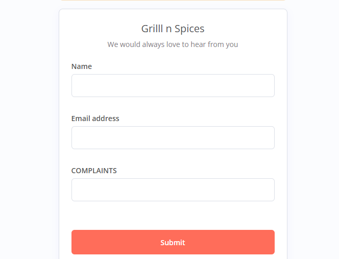
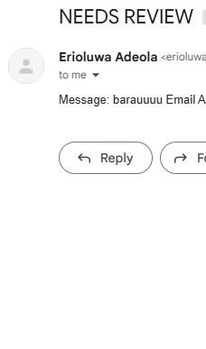

# AI Complaint Router (n8n)

An n8n workflow that reads customer complaints from a form, decides whether a human needs to look at them, splits complaints that contain more than one issue, and routes each issue to the right department.

## The problem
When every complaint lands in one place, someone has to read each one, work out which team it belongs to, and split up messages that mix several problems. A customer who writes "I was charged twice and the app keeps crashing" needs billing and technical, not one or the other. It's slow and easy to get wrong.

## What it does
1. A customer fills in the complaint form.
2. An AI model reads the complaint and decides two things: whether it needs human review (the message is unclear, full of jargon, or can't be understood), and whether it's a mixed complaint (more than one issue).
3. If it needs review, a "needs review" message goes to a human straight away and the workflow stops there.
4. If the AI understood it and it's a mixed complaint, a Split node separates it into one item per issue. If it's a single issue, it skips the split.
5. Both paths merge, and one Switch routes each item to its department: billing, technical, or sales.

## Design decisions
- **A human gets the confusing ones.** If the AI can't make sense of a complaint, it doesn't guess. It sends it to a person.
- **Mixed complaints are split, not forced into one box.** Each issue goes to the team that can actually fix it.
- **One Switch, not two.** Splitting first and merging means single and mixed complaints share the same routing logic, so there's only one place to maintain.
- **A fallback model.** If the main AI model fails, a second one takes over so the workflow keeps running.
- **Structured output.** A parser forces the AI to return the same fields every time, so the IF and Switch nodes can rely on them.

## Tech stack
n8n, [model name], [fallback model name], [notification tool].

## Screenshots

## Setup
1. Import `workflow.json` into n8n.
2. Connect your own AI model and [notification tool] credentials.
3. Replace the placeholder reviewer email with your own.
4. Activate the workflow, submit a test complaint through the form, and check that it reaches the right department.
