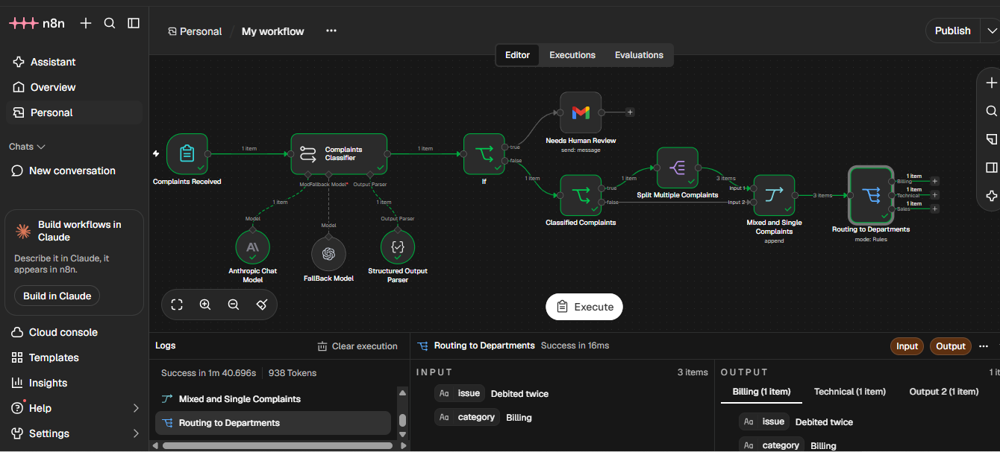

# AI Complaint Router

An n8n workflow that reads customer complaints, works out whether a human needs to look at them, splits multi-issue complaints, and routes each one to the right department.

## How it works

1. A customer fills in the complaint form.

2. An AI agent (structured output parser, main model, fallback model if the main one fails) classifies the complaint.

3. **Needs review?** If the AI can't make sense of the message (jargon, unclear text), a "needs review" message goes to a human immediately.

4. **Mixed complaint?** If it contains more than one issue (e.g. billing and technical), it is split so each issue is handled on its own.

5. Both paths merge, and a single Switch node routes each complaint to its department: Billing, Technical, or Sales.

## Why one Switch

Splitting before the Switch means single and mixed complaints both flow through the same routing logic, so there is one place to maintain instead of two.

## Tech

n8n, [model name], [fallback model name], [notification tool]

## Setup

1. Import `workflow.json` into n8n (Workflows > Import from file).
2. Add your own credentials for the AI model and [notification tool].
3. Replace the placeholder email addresses.
4. Activate the workflow and submit a test complaint through the form.

## Test cases

- Clear single complaint: goes straight to its department
- Mixed complaint: split, then routed to each department
- Unclear message: sent to a human for review

